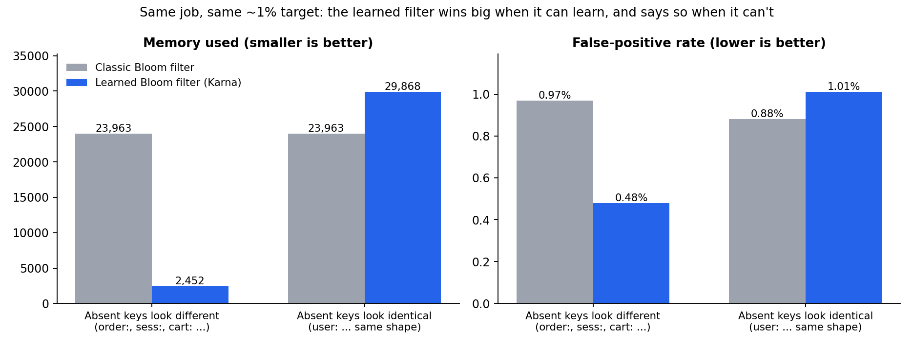
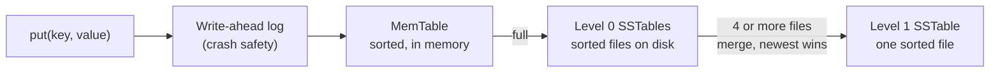
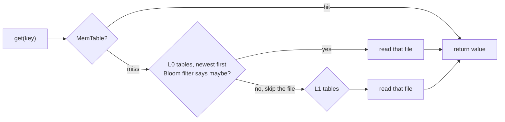
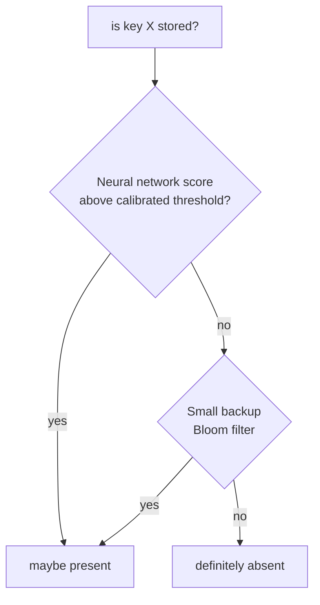

# Karna

### A database storage engine built from scratch, with a machine-learning twist that makes its lookup filters up to **10× smaller**.

[](https://github.com/Lakshya1901/Karna/actions/workflows/tests.yml)

Every big database (RocksDB, Cassandra, LevelDB, Google Bigtable) stores data using the same idea: the **LSM tree**. Karna is a from-scratch implementation of that architecture in Python (write-ahead log, memtable, SSTables, compaction, crash recovery) plus one original experiment: replacing the Bloom filters that speed up reads with a **learned Bloom filter**, a small neural network trained to recognise your data.

<p align="center"></p>

> **The honest takeaway:** when the keys you *don't* have look different from the keys you *do* have, the learned filter is **10× smaller and twice as accurate**. When they look identical, it can't learn anything, falls back to a classic filter, and ends up 25% *bigger*. Both results are measured below, and the second is the one most write-ups leave out.

---

## How data flows through the engine





**Why it's built this way:** writes only ever *append*, which is the fastest thing a disk can do, so the engine absorbs about **67,000 writes per second** in pure Python. The price is that a key could be in many files, so reads must skip as many files as possible. That's the Bloom filter's job.

## The idea: a Bloom filter that learned

A **Bloom filter** is a tiny structure that answers "is this key *definitely not* in this file?". It's how reads avoid opening files for nothing. It's very good, but it treats keys as random noise, so its size depends only on *how many* keys you have.

Real keys aren't random. `user:000…`, `order:000…` and `session:000…` look different. So Karna trains a small neural network to separate "keys we store" from "keys people ask for that we don't have":



- Keys the model confidently recognises skip the classic filter completely.
- Any stored key the model *misses* goes into the small backup filter, so there are **never false negatives** (a stored key is never reported missing). This is tested.
- The threshold is calibrated on **held-out** absent keys so the false-positive rate is a *target you set*, not a hope.

### Measured results

20,000 stored keys, 10,000 absent test keys, both filters aimed at about 1% false positives (`python3 karna/benchmarks/benchmark.py`):

| Absent keys look... | Classic Bloom filter | Learned Bloom filter |
|---|---|---|
| **different** from stored keys (`order:`, `sess:`, `cart:`) | 0.97% false positives, 23,963 bytes | **0.48% false positives, 2,452 bytes** |
| **identical** to stored keys (`user:` with the same shape) | 0.88% false positives, 23,963 bytes | 1.01% false positives, 29,868 bytes |

The trade-off is real. In this Python implementation a learned lookup takes about 150–240 µs against 6–8 µs for a classic one, because it runs a neural-network forward pass. So the learned filter pays off when memory is the constraint and the data has structure.

## What's in the box

| Component | What it does |
|---|---|
| [`memtable.py`](karna/storage/memtable.py) | sorted in-memory write buffer with deletion markers (tombstones) |
| [`sstable.py`](karna/storage/sstable.py) | immutable sorted files with a sparse index, a footer and a per-file Bloom filter sized to the file's key count |
| [`lsm_engine.py`](karna/storage/lsm_engine.py) | `put` / `get` / `delete`, write-ahead-log replay, flushing, compaction |
| [`learned_bloom.py`](karna/indexes/learned_bloom.py) | the learned filter: structural key features, small neural network, threshold calibration, backup filter |
| [`benchmark.py`](karna/benchmarks/benchmark.py) | throughput, latency and filter benchmarks that produce the numbers above |

## Engineering notes

Bugs found and fixed while validating the engine, because they're the interesting part:

- **Per-file Bloom filters were a fixed 1,024 bits.** Any file with more than a few hundred keys filled the filter up, so every lookup opened every file. Filters are now sized from each file's real key count.
- **Hash positions repeated once the filter used more than three hashes.** They now use double hashing (Kirsch–Mitzenmacher), which gives independent-looking positions for any count.
- **The first learned filter had a 48% false-positive rate.** It fed *hashed* keys to the model, which destroys all structure, and used a fixed 0.5 threshold. It now uses structural features (leading characters, length, digit and letter ratios) and a calibrated threshold.
- **A newest-wins test across repeated compactions** and a **tombstone-shadowing test** guard against the classic LSM bug where a deleted key reappears from an older file.

## Run it

```bash
pip install -r requirements.txt
pytest -q                               # 13 tests: reads across compactions, deletes, crash recovery, filters
python3 karna/benchmarks/benchmark.py   # reproduces every number in this README
python3 docs/make_chart.py              # redraws the comparison chart
```

```python
from karna.storage.lsm_engine import LSMEngine

db = LSMEngine("./data")
db.put("user:42", b"Ada")
db.get("user:42")     # b"Ada"
db.delete("user:42")
db.get("user:42")     # None
db.close()
```

## Limits and next steps

- Compaction is a single Level 0 → Level 1 merge. Leveled compaction with per-level size targets, and dropping deletion markers at the bottom level, are the next steps.
- It's a single-node engine. Replication (Raft) would sit on top of it.
- Throughput is CPython-bound. A Rust port is the planned way to close that gap, but it isn't part of this repository yet.

## References

- Kraska et al., *The Case for Learned Index Structures*, SIGMOD 2018
- Mitzenmacher, *A Model for Learned Bloom Filters*, NeurIPS 2018
- O'Neil et al., *The Log-Structured Merge-Tree (LSM-Tree)*, Acta Informatica 1996

MIT License, see [LICENSE](LICENSE).
